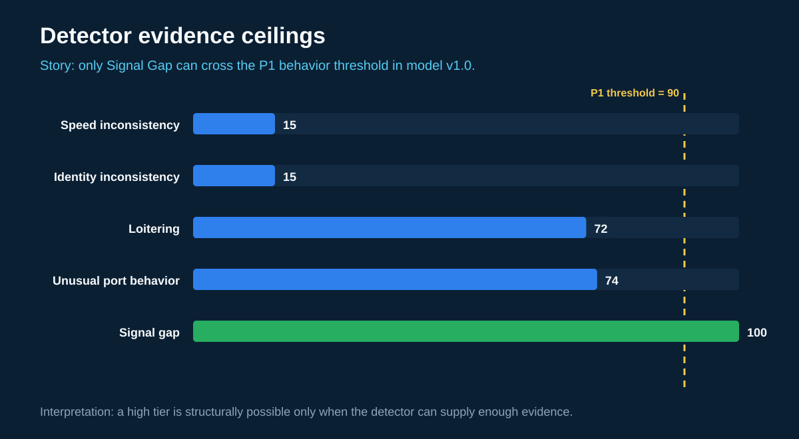
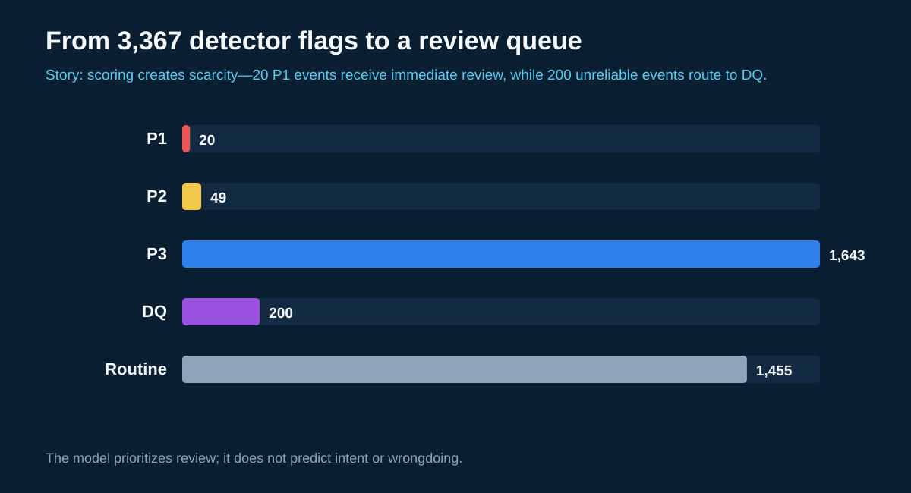
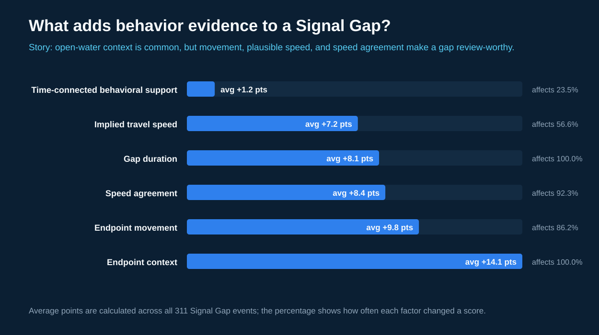
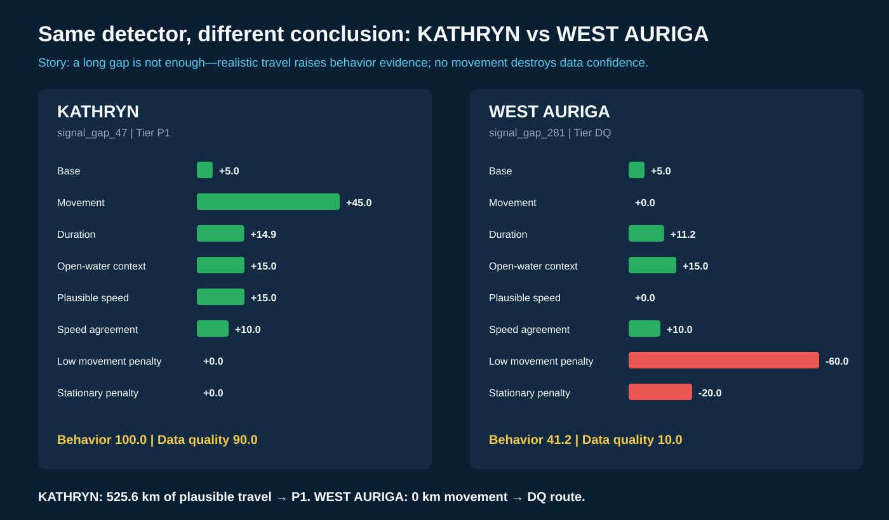

# Power BI Dashboard Guide

## Purpose

The dashboard should show how 7.28 million raw AIS records become a small,
auditable set of review candidates. It must distinguish behavioral leads from
data-quality problems and operational context. An alert is not proof of
wrongdoing.

The operational review queue comes from the evidence-based priority model. The
19-row manual sample remains a validation artifact and is never presented as
the 19 highest-priority events.

The report is saved as
`data/powerbi/maritime_anomaly_dashboard_priority.pbix`. Its established
analysis path contains seven operational pages:

1. `Overview`
2. `Signal Gap Analysis`
3. `Validation Sample`
4. `Manual Validation`
5. `Rule Descriptions`
6. `Priority Model`
7. `P1 Queue`

The two priority pages are the operational path. `Priority Model` explains the
two-score routing and reconciles all five tier counts. `P1 Queue` is filtered
to exactly 20 events and shows event ID, vessel, behavior evidence, data
quality, and the generated review reason. The two validation pages preserve
the original 19-row learning exercise without presenting it as ranking output.

An additional model-mechanics canvas and four reproducible visual assets now
explain what enters the score. Generate those assets with:

```powershell
python src/reporting/build_priority_story_charts.py
```

They are written to `docs/images/priority_model/` and can be inserted into the
report as static explanation panels without changing filters or model results.

Generate the reporting tables from the repository root:

```powershell
python src/reporting/build_powerbi_dataset.py
```

The command validates keys and golden row counts before writing files to
`data/powerbi/`.

For the exact Python transformation stages, executed commands, test results,
and an interview-style explanation of the engineering decisions, see
[`powerbi_reporting_walkthrough.md`](powerbi_reporting_walkthrough.md).

## Tables

| Table | Grain | Expected rows | Purpose |
| --- | --- | ---: | --- |
| `fact_anomaly_events.csv` | One detector event | 3,367 | Main map, trends, evidence, and alert breakdowns |
| `dim_vessels.csv` | One MMSI | 1,822 | Vessel attributes and one-to-many filtering |
| `dim_anomaly_types.csv` | One detector type | 5 | Friendly labels, definitions, and analysis lanes |
| `fact_overlap_pairs.csv` | One detector pair and overlap measure | 20 | Any-time versus two-hour overlap comparison |
| `fact_manual_review.csv` | One manually reviewed event | 19 | Evaluation results and evidence-backed verdicts |
| `fact_priority_score_components.csv` | One event and scoring component | 31,843 | Long-form score audit trail |
| `priority_factor_summary.csv` | One detector and scoring factor | 42 | Factor frequency and contribution summary |
| `dim_detector_score_ceilings.csv` | One detector type | 5 | Structural behavior-score ceilings and P1 reachability |
| `dim_priority_tiers.csv` | One priority tier | 5 | Tier thresholds and routing descriptions |

## Power BI import

1. Open Power BI Desktop.
2. Select **Get data**, then **Text/CSV**.
3. Import all five CSV files from `data/powerbi/`.
4. Open **Model view**.
5. Create these one-to-many, single-direction relationships:

```text
dim_vessels[vessel_key]          1 ─── * fact_anomaly_events[vessel_key]
dim_anomaly_types[anomaly_type]  1 ─── * fact_anomaly_events[anomaly_type]
dim_vessels[vessel_key]          1 ─── * fact_manual_review[vessel_key]
dim_anomaly_types[anomaly_type]  1 ─── * fact_manual_review[anomaly_type]
```

Keep `fact_overlap_pairs` disconnected. It already contains aggregated pairwise
results and should not filter the event fact table.

Set `MMSI` to **Text** or use `vessel_key` in visuals. Set latitude and longitude
to decimal number, timestamps to date/time, counts to whole number, and overlap
rates and event share to percentage.

## Core measures

Create the following measures in `fact_anomaly_events`:

```DAX
Total Events = COUNTROWS(fact_anomaly_events)

Unique Vessels = DISTINCTCOUNT(fact_anomaly_events[vessel_key])

High Suspicion Events =
CALCULATE(
    [Total Events],
    fact_anomaly_events[suspicion_level] = "high"
)

P1 Events =
CALCULATE(
    [Total Events],
    fact_anomaly_events[priority_tier] = "P1"
)

Data Quality Queue =
CALCULATE(
    [Total Events],
    fact_anomaly_events[priority_tier] = "DQ"
)

Average Behavior Evidence =
AVERAGE(fact_anomaly_events[behavior_evidence_score])

Average Data Quality =
AVERAGE(fact_anomaly_events[data_quality_score])

Plausible Travel Gaps =
CALCULATE(
    [Total Events],
    fact_anomaly_events[triage_description] = "Plausible-travel signal gap"
)

Reviewed Events = COUNTROWS(fact_manual_review)

Investigation-Worthy Reviews =
CALCULATE(
    [Reviewed Events],
    fact_manual_review[verdict] = "investigation_worthy"
)
```

## Recommended pages

### 1. Pipeline overview

Use cards for 3,367 events, 1,822 vessels, 20 P1 events, and 200 events routed
to data-quality review. Add a bar chart by anomaly type and a second chart by
priority tier.

Story: the detectors reduce 7.28 million pings to 3,367 events, but the priority
model is required because loitering produces 87.1% of alerts and volume alone
cannot determine analytical value.

### 2. Priority model

Use a scatter plot with `behavior_evidence_score` on the x-axis and
`data_quality_score` on the y-axis. Use `priority_tier` as the legend and
`event_id` as Details. Add vessel, rule, review reason, and supporting rules as
tooltips. Add reference lines at behavior 90 and data quality 50.

Story: the upper-right contains strong, interpretable behavioral evidence. The
lower area contains events that must be treated as data-quality problems rather
than behavioral findings.

### 3. P1 investigation queue

Filter the page to `priority_tier = P1`. Add a ranked table with vessel, scores,
duration, movement, implied speed, supporting rules, and review reason. Add an
event map using `event_lat` and `event_lon`. A vessel or event slicer should
filter every visual on the page.

Story: these 20 events were selected by the evidence model, not manually
sampled. Selecting one event reveals the complete reason it reached P1.

### 4. Signal-gap evidence

Filter to Signal gap. Use a scatter plot with duration hours on the x-axis,
movement distance on the y-axis, implied average speed as tooltip, and endpoint
context as legend. Color by priority tier and add a table of the ranked gaps.

Story: gap duration alone is insufficient. KATHRYN is stronger than a longer
zero-movement gap because 525.6 km of travel at 14.3 knots is physically
consistent with its reported speeds.

### 5. Data quality

Filter to `priority_tier = DQ`. Show behavior evidence versus data-quality
score and a table of low-movement reporting gaps, impossible position jumps,
and the plain-language review reason.

Story: some anomaly rules protect downstream analysis by detecting unreliable
AIS records rather than suspicious behavior.

### 6. Manual validation

Use the 19-row manual review table. Show verdict count by detector, the evidence
description, and reviewer notes. Display the limitation that the sample is
balanced for detector comparison and is not a population accuracy estimate.

Story: 3 reviews were investigation-worthy, 6 were data-quality problems, 7
looked likely normal, and 3 needed more context. All three investigation-worthy
cases route to P1, while all six data-quality cases route to DQ. This is a
sanity check, not a measured accuracy rate.

### 7. Rule descriptions and overlap

Show the definition and analysis lane for every rule. Under the definitions,
use grouped bars for shared-vessel count by detector pair and overlap measure.
Show normalized overlap rate in a tooltip or secondary table.

Story: 112 vessels triggered multiple detector types during the day, but only
82 had different rules firing within two hours. Loitering plus signal gap was
the strongest connected pair with 71 vessels.

### 8. Model mechanics

Use the detector-ceiling chart, the priority funnel, and the Signal Gap factor
chart. Keep the 90-point P1 threshold visible.

Story: detectors do not start with equal mathematical reach. Signal Gap is the
only rule that can reach P1 in model v1.0. Loitering and unusual-port behavior
can reach P2, while speed and identity inconsistencies mainly protect the
analysis from bad source data.







### 9. Score anatomy

Use the KATHRYN versus WEST AURIGA comparison and an event table containing
`event_id`, both scores, tier, score breakdowns, review reason, and tier
decision.

Story: both events contain a long reporting gap, but only KATHRYN shows 525.6
km of physically plausible travel. WEST AURIGA returns at the same position,
which removes behavioral confidence and sends it to data-quality review.



## Interview transition between pages

1. **Overview → Signal Gap:** volume is dominated by loitering, so move to the
   detector that supplies the strongest distinct behavioral evidence.
2. **Signal Gap → Model mechanics:** duration alone cannot separate meaningful
   travel from a stationary reporting outage, so explain the individual factors.
3. **Model mechanics → P1 queue:** once the scoring math and tier gates are
   visible, show the 20 records that actually satisfy them.
4. **P1 queue → Score anatomy:** select one strong and one weak example to prove
   that the ranking is explainable at event level.
5. **Score anatomy → Manual validation:** compare deterministic ranking against
   the independent 19-event evaluation sample as a sanity check, not as model
   training data.

## Design rules

- Prefer a dark navy background with restrained blue and amber accents.
- Use red only for data-quality failures or truly exceptional values, not every
  automated alert.
- Put definitions in tooltips so the dashboard does not imply guilt or intent.
- Use `priority_tier` and the two evidence scores before the legacy
  `suspicion_level` in the visual hierarchy.
- Display exact counts and units. Avoid unsupported risk scores.
- Always explain that the scores prioritize review and do not predict intent.
- Keep a visible note that the current dataset covers one day: January 15, 2024.

## Readiness criteria

The dataset is ready for Power BI when the reporting command prints
`POWER BI DATASET PASSED`, all reporting files load, relationships are one-to-many,
and the card totals reconcile to the manifest.

The current reporting build meets those criteria. The anomaly-event fact now
contains 86 columns, including every score contribution and a readable tier
decision. The score-component fact contains 31,843 auditable rows, and the P1
result reconciles to the 20-event score guardrail.

## Rebuild the interview report

Generate the data, charts, and final report copy in this order:

```powershell
python src/reporting/build_powerbi_dataset.py
python src/reporting/build_priority_story_charts.py
python src/reporting/embed_priority_story_in_pbix.py
python -m unittest tests/test_powerbi_reporting.py -v
```

The final command writes
`data/powerbi/maritime_anomaly_dashboard_priority_story_final.pbix`. It preserves the
original PBIX and adds two image-driven story pages:

- `Model Mechanics`: detector ceilings, the review funnel, and Signal Gap
  factor contributions.
- `Score Anatomy`: the event-level KATHRYN versus WEST AURIGA comparison.

The image pages are intentionally generated from version-controlled evidence
tables. This keeps the interview narrative reproducible and prevents a manual
Power BI edit from silently changing the scoring explanation.
